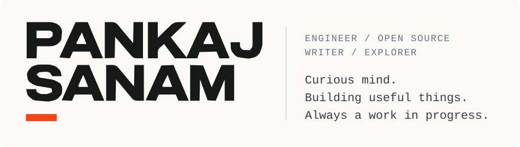

  <a href="https://sanam.id">Website</a>
  &nbsp; / &nbsp;
  <a href="https://slashism.com">Writing</a>
  &nbsp; / &nbsp;
  <a href="https://x.com/aghorism">X</a>
  &nbsp; / &nbsp;
  <a href="https://www.linkedin.com/in/pankajsanam">LinkedIn</a>

I build developer tools, coding-agent workflows, and quiet places to write. Most of it is open source and lives under [potion.sh](https://potion.sh).

## Tools for coding agents

<table>
  <tr>
    <td width="50%" valign="top">
      <h3><a href="https://github.com/antick/loadout">Loadout</a></h3>
      
One home for your agent skills. Organize them once, use them across Codex, Claude Code, Cursor, and more.

      
TypeScript

      <a href="https://loadout.potion.sh"><strong>Website</strong></a> · <a href="https://github.com/antick/loadout"><strong>Source</strong></a>
    </td>
    <td width="50%" valign="top">
      <h3><a href="https://github.com/antick/capsule">Capsule</a></h3>
      
A quiet macOS edge dock that keeps agent activity, token use, and reset times in sight.

      
Swift · <code>brew install --cask antick/tap/capsule</code>

      <a href="https://github.com/antick/capsule/releases/latest"><strong>Download</strong></a> · <a href="https://github.com/antick/capsule"><strong>Source</strong></a>
    </td>
  </tr>
  <tr>
    <td width="50%" valign="top">
      <h3><a href="https://github.com/antick/skills">Skills</a></h3>
      
Reusable engineering workflows and project rules for Codex, Claude Code, Pi, and OpenCode.

      
JavaScript

      <a href="https://skills.potion.sh"><strong>Website</strong></a> · <a href="https://github.com/antick/skills"><strong>Source</strong></a>
    </td>
    <td width="50%" valign="top">
      <h3><a href="https://github.com/antick/ragereport">Rage Report</a></h3>
      
Counts your swears and your pleases across local agent histories. Runs offline, no account, no upload.

      
TypeScript · CLI

      <a href="https://ragereport.potion.sh"><strong>Website</strong></a> · <a href="https://github.com/antick/ragereport"><strong>Source</strong></a>
    </td>
  </tr>
</table>

## Writing and notes

<table>
  <tr>
    <td width="50%" valign="top">
      <h3><a href="https://github.com/antick/copper">Copper</a></h3>
      
A local-first desktop Markdown workspace. Notes stay in your folders, with search and properties built in.

      
TypeScript · Desktop

      <a href="https://copper.potion.sh"><strong>Website</strong></a> · <a href="https://github.com/antick/copper"><strong>Source</strong></a>
    </td>
    <td width="50%" valign="top">
      <h3><a href="https://github.com/antick/astro-paperline">Paperline</a></h3>
      
A paper-inspired Astro blog theme with search, topics, archives, and dark mode.

      
Astro

      <a href="https://paperline.potion.sh"><strong>Live demo</strong></a> · <a href="https://github.com/antick/astro-paperline"><strong>Source</strong></a>
    </td>
  </tr>
</table>

## Small things

| Project | What it does |
| --- | --- |
| [Pookie](https://github.com/antick/pookie) | A cat that lives on your macOS screen, climbs your windows, and never steals focus. Up to ten animals from a set of 22. |
| [Netflix Hidden Categories](https://github.com/antick/netflix-categories-chrome) | Chrome extension for Netflix's secret genre codes. [Install](https://chromewebstore.google.com/detail/netflix-hidden-categories/ahpajhekpgjoijmcomaffmljeafacemc) · [Website](https://netflix-categories.potion.sh) |
| [Awesome Resources](https://github.com/antick/awesome-resources) | A running list of tools and reading I keep coming back to. |
| [VPS Setup](https://github.com/antick/vps-setup-php) | One script to set up an Ubuntu box for PHP and Node. |

<strong>Older and archived work</strong>

 

| Project | Notes |
| --- | --- |
| [Hashnode Custom CSS](https://github.com/antick/hashnode-custom-css) | Custom styles for Hashnode blogs. 22 stars. |
| [Radium](https://github.com/antick/radium) | Medium-inspired HTML template on Tailwind CSS. |
| [React Crisp UI](https://github.com/antick/react-crisp-ui) | Small React component kit. [npm](https://www.npmjs.com/package/react-crisp-ui) |
| [Skyii](https://github.com/antick/skyii) | Starter kit for Yii2. |
| [VS Code Settings](https://github.com/antick/vscode-settings) | Extensions and settings I used. |
| [Ubuntu Resolution](https://github.com/antick/ubuntu-resolution) | Push Ubuntu past your monitor's native resolution. |
| [JS Helper](https://github.com/antick/js-helper) | jQuery utilities from 2013. |

## Writing

At [Slashism](https://slashism.com) I turn what I learn while building into tutorials on code, systems, and AI.
