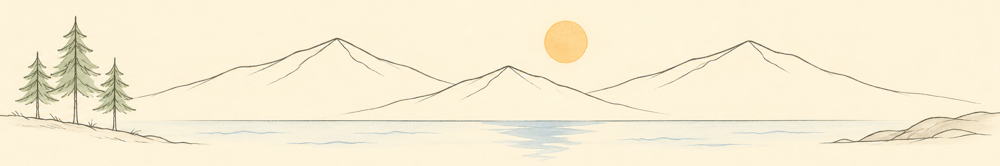

  

  <a href="https://potion.sh">Website</a>
  &nbsp; / &nbsp;
  <a href="https://x.com/bucketment">X</a>
  &nbsp; / &nbsp;
  <a href="https://www.linkedin.com/in/pankajsanam">LinkedIn</a>

## Tools for coding agents

<table>
  <tr>
    <td width="50%" valign="top">
      <h3><a href="https://github.com/antick/loadout">Loadout</a></h3>
      
One home for your agent skills. Organize them once, use them across Codex, Claude Code, Cursor, and more.

      
TypeScript

    </td>
    <td width="50%" valign="top">
      <h3><a href="https://github.com/antick/capsule">Capsule</a></h3>
      
A quiet macOS edge dock that keeps agent activity, token use, and reset times in sight.

      
Swift · <code>brew install --cask antick/tap/capsule</code>

      <a href="https://github.com/antick/capsule/releases/latest"><strong>Download</strong></a>
    </td>
  </tr>
  <tr>
    <td width="50%" valign="top">
      <h3><a href="https://github.com/antick/skills">Skills</a></h3>
      
Reusable engineering workflows and project rules for Codex, Claude Code, Pi, and OpenCode.

      
JavaScript

    </td>
    <td width="50%" valign="top">
      <h3><a href="https://github.com/antick/ragereport">Rage Report</a></h3>
      
Counts your swears and your pleases across local agent histories. Runs offline, no account, no upload.

      
TypeScript · <code>npx ragereport</code>

    </td>
  </tr>
</table>

## Apps, extensions, and themes

<table>
  <tr>
    <td width="50%" valign="top">
      <h3><a href="https://github.com/antick/copper">Copper</a></h3>
      
A local-first desktop Markdown workspace. Notes stay in your folders, with search and properties built in.

      
TypeScript · Desktop

    </td>
    <td width="50%" valign="top">
      <h3><a href="https://github.com/antick/pookie">Pookie</a></h3>
      
A cat that lives on your macOS screen, climbs your windows, and never steals focus. Up to ten animals from a set of 22.

      
Swift · macOS

      <a href="https://github.com/antick/pookie/releases/latest"><strong>Download</strong></a>
    </td>
  </tr>
  <tr>
    <td width="50%" valign="top">
      <h3><a href="https://github.com/antick/netflix-categories-chrome">Netflix Hidden Categories</a></h3>
      
A Chrome extension for browsing Netflix's hidden categories and secret genre codes.

      
TypeScript · Chrome extension

      <a href="https://chromewebstore.google.com/detail/categories-for-netflix-un/dhmkkdcngbedlfggdpdnoahebcdnmdlj"><strong>Install</strong></a>
    </td>
    <td width="50%" valign="top">
      <h3><a href="https://github.com/antick/astro-paperline">Paperline</a></h3>
      
A paper-inspired Astro blog theme with search, topics, archives, and dark mode.

      
Astro · Blog theme

    </td>
  </tr>
  <tr>
    <td width="50%" valign="top">
      <h3><a href="https://github.com/antick/batcave">Batcave</a></h3>
      
A Batman-inspired Astro portfolio and blog template with eight themes, project showcases, search, and a personal shelf.

      
Astro · Portfolio and blog template

    </td>
    <td width="50%" valign="top"></td>
  </tr>
</table>
